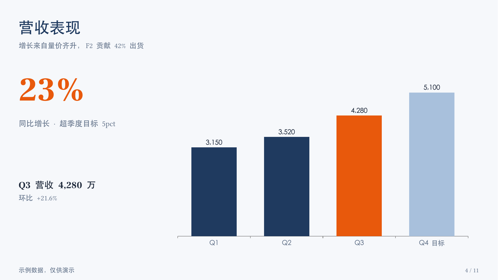
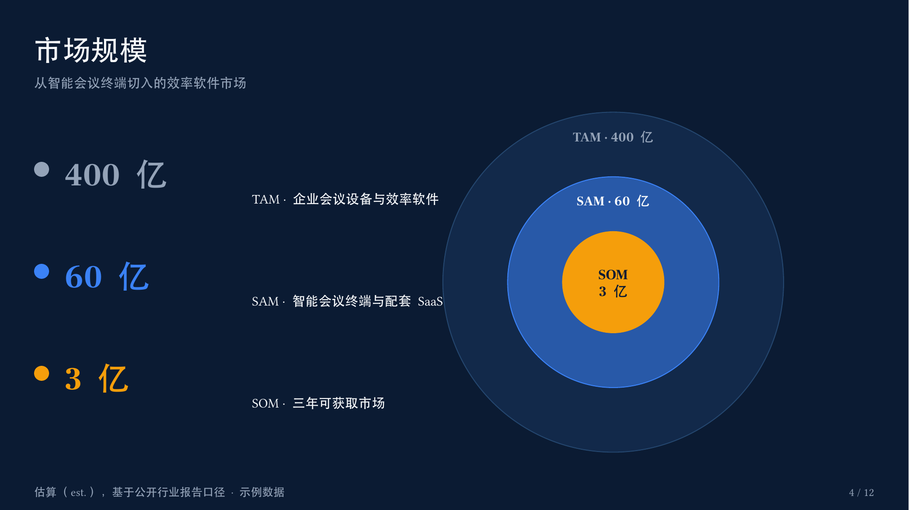
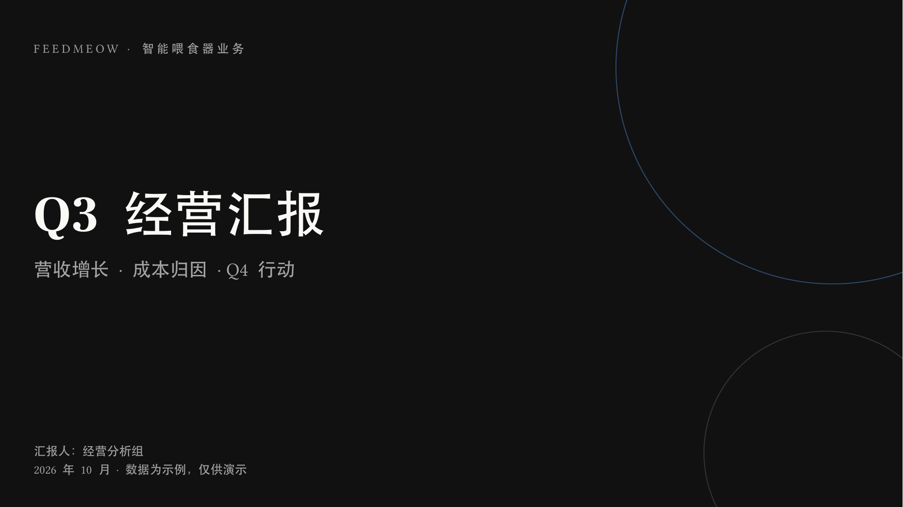

# Office-Agent · PPT 生成 Agent

**把任意输入变成拿得出手的 PPT，并在对话中持续打磨。**
一段话、一份文档、一张白板照片——都可以是起点；生成之后，你在对话里说"换个深色风格""第 3 页数据更新一下""加一页竞品分析"，Agent 改的是可再生的源码工作区，重建即可验证。

> English summary below · [English](#english)

| 汇报风格 | 路演风格 | 高端风格 |
|---|---|---|
|  |  |  |

*三个样例均由本 Agent 的真实管线生成，源文件见 [examples/](examples/)。*

## 凭什么不一样

一句话：**别人交付"一份文件"，这里交付"可维护的 PPT 源码工程 + 会成长的 Agent"。**

| 能力 | 主流 AI PPT 工具<br>(模板填充 / 网页生成类) | Office Copilot | **Office-Agent** |
|---|---|---|---|
| 输入 | 主题、大纲 | 现有文档 | 一段话 / docx·pdf·xlsx / **白板照片** / 风格参考图 / 已有 .pptx |
| 产出 | 套模板的页面，导出常乱 | 编辑建议 | **原生可编辑 .pptx**（图表、形状全原生） |
| 修改 | 整篇重新生成 | 手动改 | **对话改源码层，精准重建**，其余页像素级不变 |
| 记忆 | 无 | 会话内 | **跨 deck 偏好 / 反馈 / 作品索引** |
| 质量门 | 无 | 无 | **程序化检查 + 渲染 + 视觉验收，不通过不交付** |
| 数据 | 常编造 | — | 有来源或标注 est.，**不编造数字** |
| 设计 | 模板库锁定 | 母版 | 设计 token 系统 + 防"AI 味"硬规则 |
| 部署 | 云端 SaaS | 随 Office | **开源本地运行**，数据不出机器 |

五个核心亮点：

1. **PPT 源码工程（deck-as-code）** —— 每份 PPT = `outline.md`（内容）+ `theme.js`（设计）+ `build.js`（构建）。可 diff、可回滚、可自动化；别人给你文件，我们给你编译器。
2. **精准迭代，不伤其他页** —— "第 3 页换数据"只动第 3 页，重新生成不会毁掉你调过的所有细节。
3. **一键换肤：风格是参数，不是模板** —— 同一份构建脚本，换一个 theme.js 就是另一种气质：

   | 墨蓝商务（浅色） | 深空蓝金（深色） | 曜石金（高端） |
   |---|---|---|
   |  |  |  |

   ```bash
   THEME=./theme-dark.js OUT=深色版.pptx node build.js   # 构建脚本零改动
   ```

4. **不合格不交付** —— 溢出/重叠/越界程序化检查 → LibreOffice 渲染 → 视觉验收循环，QA 结果随交付报告给出。
5. **越用越懂你** —— 偏好与反馈沉淀进 `memory/`，第二份 PPT 起自动带上你的风格；数据不出本机。

## 特性

- **多模态摄入** —— 一段话（推断补全）、文档（docx/pdf/md/xlsx，markitdown 提取）、图片（白板照片/手写笔记做内容源，参考图做风格源）、已有 .pptx（默认重建，或按模板继承修改）
- **对话式迭代** —— 每份 PPT 是一个可再生工作区（大纲 + 设计 token + 构建脚本），改哪层修哪层，重建 + QA 自动验证
- **记忆** —— 记住你的视觉偏好、设计反馈与作品索引（`memory/`），越用越懂你
- **风格自适应** —— 汇报 / 路演 / 高端三套预设自动选择，也可用自然语言任意指定；高端档逐案定制设计方向；**“照这个风格做”**：`theme_from_image.py` 从参考图/海报提取配色生成 theme（背景聚类 + 主强调色提取 + 深浅自动判定），换肤零代码改动
- **动效注入** —— pptxgenjs 不支持动画？`animate.py` 做 OOXML 后处理，`anim.json` 声明式驱动：切换动效大家族（zoom/push/split/wheel/comb…）、元素进场/退场（fade/wipe/flyIn/zoomIn/棋盘/百叶窗/轮辐…）、**强调**（脉冲/旋转/变色/缩放）、**路径动画**、**图表按类逐根升起**（PowerPoint；WPS 兼容模式下图表随页面显示）、**逐段文字进场**，`objectName` 精准指向元素。全套效果演示见 [examples/effects-showcase](examples/effects-showcase/)
- **动效素材** —— `fetch_assets.py` 联网搜索下载免费商用动态视频（Mixkit，许可自动存档），`make_motion.py` 由 theme 配色本地生成无缝循环动效 GIF（零网络/零积分兜底）；内嵌封面/章节页作氛围层（视频垫底+压暗+文字在上）
- **本地质感层** —— `make_bg.py` 由 theme 配色生成渐变背景（对角渐变+暗角+光带+颗粒）与辉光素材，垫在大数字/标题后——不耗 AI 积分，告别平铺色
- **QA 门** —— 程序化检查（溢出/重叠/越界/占位符）+ LibreOffice 渲染 + 视觉验收，不通过不交付

## 工作原理

```
读记忆 → 多模态摄入 → 风格决策 → 大纲 → 设计token → pptxgenjs 构建
   ↑                                                      ↓
记忆更新 ← 交付 ← 视觉验收 ← 渲染PNG ← qa_check.py ←──────┘
                    （对话式迭代：改大纲 / token / 脚本，循环重建）
```

双状态模型：

- `decks/<name>/` —— 单份 PPT 的源码工作区：`brief.md`（需求纪要）、`outline.md`（内容唯一事实源）、`theme.js`（设计 token）、`build.js`（构建脚本）、产物 `.pptx`
- `memory/` —— 跨 deck 的用户级记忆：`profile.md`（偏好画像）、`feedback.md`（反馈→设计规则）、`decks.md`（作品索引）

## 安装

前置：[ZCode](https://zcode.ai)（Agent 运行环境）、Node ≥ 18、Python ≥ 3.10。

```bash
git clone https://github.com/<you>/Office-Agent.git
cd Office-Agent && npm install          # pptxgenjs
pip3 install python-pptx "markitdown[pptx,docx]" defusedxml pillow   # 解析/QA/质感素材
```

渲染验收依赖（一次性）：

```bash
# macOS
brew install --cask libreoffice && brew install poppler
# Linux
sudo apt-get install libreoffice poppler-utils
```

**macOS 中文预览修复**（此版本 LibreOffice 不枚举系统字体，预览中文会空白）：

```bash
cp /System/Library/Fonts/STHeiti*.ttc /Applications/LibreOffice.app/Contents/Resources/Fonts/truetype/
```

可选：[dreamina（即梦）CLI](https://dreamina.com) —— 高端风格 AI 配图用，消耗积分；未安装或零积分时自动回退纯设计封面。

## 用法

在本项目目录打开 ZCode，直接说话即可：

```text
帮我做一份 Q3 经营汇报，重点讲营收和成本
根据 这份产品资料.docx 做一版融资路演
照这张白板照片安排发布会 PPT
照这张海报的风格做（参考图 → 自动提取配色生成 theme）
```

生成后继续对话迭代：

```text
整体换成深色风格
把市场页换成同心圆图示
再加一页双十一备战
给数据页加图表擦除的进场动效
封面图换个更抽象的
```

动效示例（deck 工作区里的 `anim.json`，由 `animate.py` 注入）：

```json
{
  "transition": {"type": "fade", "speed": "med"},
  "slides": {
    "4": [{"target": "kpi-growth",  "effect": "pulse", "trigger": "afterPrev", "dur": 600},
          {"target": "chart-revenue", "effect": "wipe", "dir": "up",
           "chart": "category", "trigger": "afterPrev", "dur": 700}],
    "6": [{"target": "bullets", "effect": "fade", "byPara": true, "trigger": "click", "dur": 350}]
  }
}
```

也可以显式派发子代理：`用 ppt-designer 帮我改一下上次那份路演 PPT`。

## 风格预设

| 风格 | 适用 | 设计基调 | AI 配图 |
|---|---|---|---|
| 汇报 | 周月季汇报、总结复盘 | 浅色三明治、图表+大数字、结论先行 | 否（快、可编辑） |
| 路演 | 融资、商务提案 | 全深色、叙事弧线、数据说服 | 封面可选 |
| 高端 | 发布会、品牌、决审 | 逐案定制（先出设计方向）、大留白 | 是（dreamina，零积分回退纯设计） |

设计 token 统一 BACKGROUND → PRIMARY → ACCENT 三角色模型，见 [references/design-tokens.md](.agents/skills/ppt-designer/references/design-tokens.md)。

## 目录结构

```
├── .zcode/agents/ppt-designer.md      # 子代理定义（自动派发）
├── .agents/skills/ppt-designer/       # 主技能：流程 + references + scripts
├── decks/                             # 运行时工作区（gitignore）
├── memory/                            # 运行时记忆（gitignore，含个人数据）
├── examples/                          # 三个真实生成的样例（含 preview）
└── docs/architecture.md               # 架构决策
```

## 隐私

`memory/` 与 `decks/` 含个人偏好与业务数据，已被 `.gitignore` 排除，不会进入仓库；记忆文件也不应被提交、张贴或发送到外部服务。

## English

**Office-Agent** is a ZCode agent that turns anything — a sentence, a document (docx/pdf/md/xlsx), a whiteboard photo — into a presentation you could actually use, then keeps refining it through conversation.

- **Regenerable deck workspace**: every deck keeps `outline.md` + `theme.js` + `build.js`; edits are made at the source layer and rebuilt, never patched into the binary.
- **Memory**: user preferences, design feedback and a deck index live in `memory/` (gitignored).
- **Style presets**: report / pitch / premium, auto-selected and overridable in natural language; premium runs a bespoke design direction with optional AI imagery (falls back to pure design when out of credits).
- **QA gate**: scripted overflow/overlap checks + LibreOffice render + visual review before delivery.

See [docs/architecture.md](docs/architecture.md) for design decisions, and [examples/](examples/) for three decks produced end-to-end by the real pipeline.

## License

[MIT](LICENSE) · 本项目为原创内容，不包含第三方技能/插件的文本；运行时依赖（ZCode presentations 插件、LibreOffice、poppler、dreamina）由使用者自行安装。
